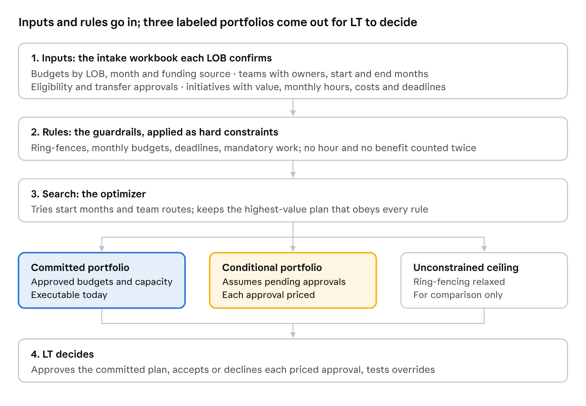
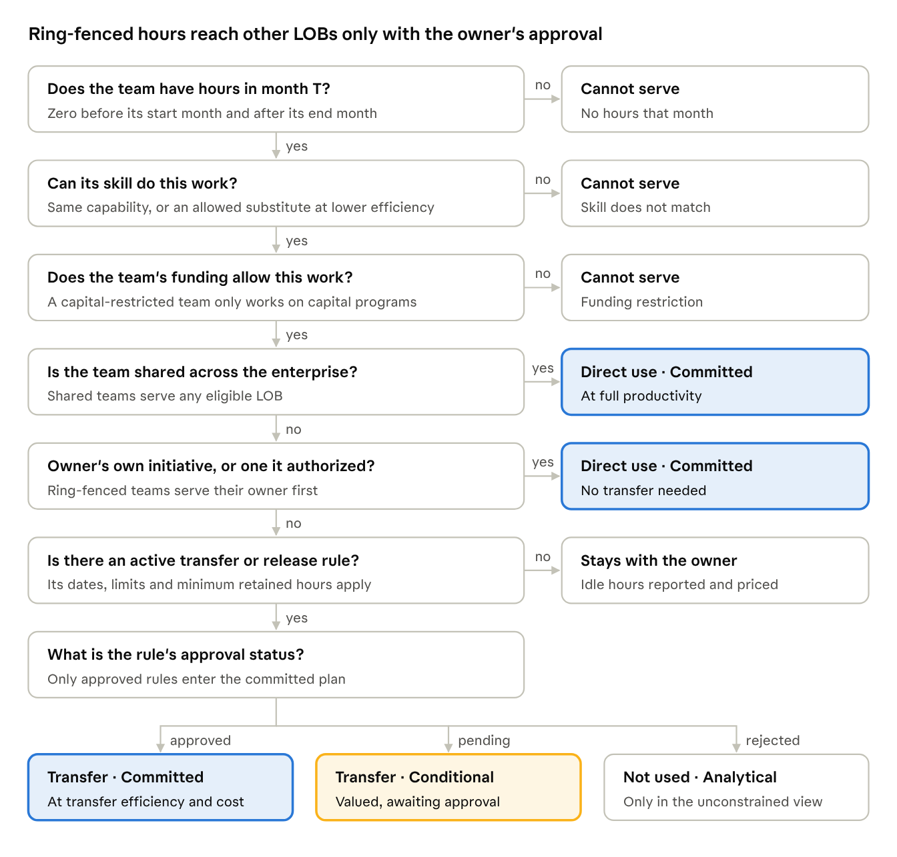
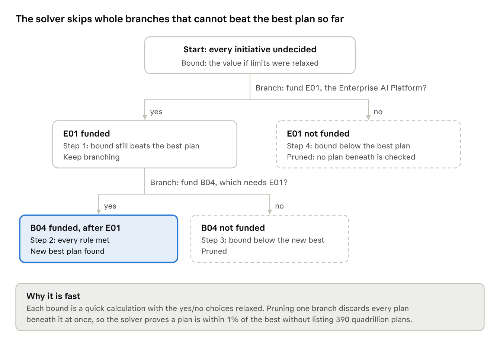
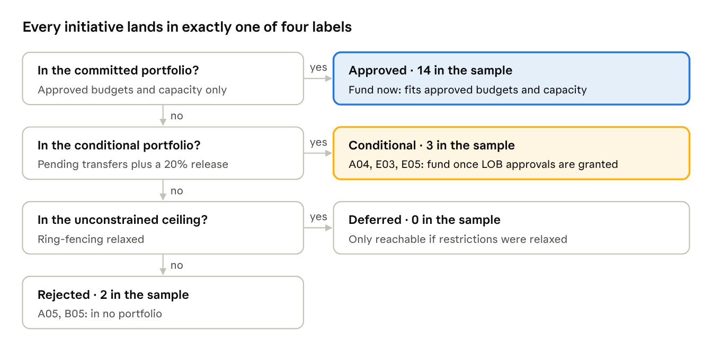
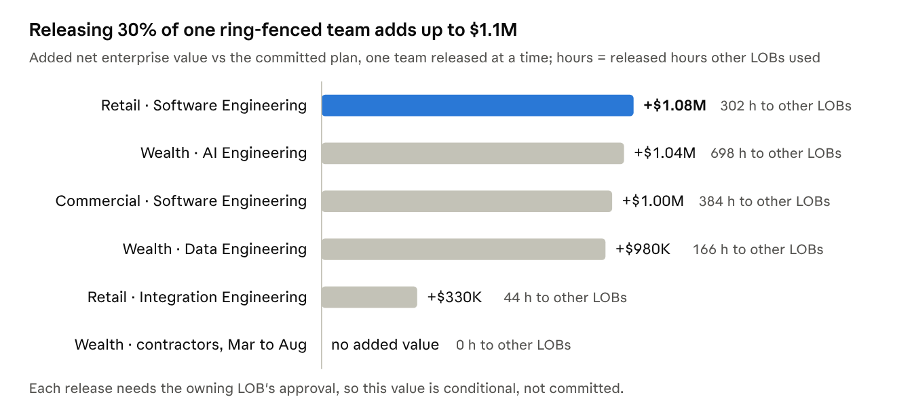

# How the Frontier Portfolio IQ Solver Decides

Nov 21, 2026 · Explainer for the leadership team and portfolio staff

> Repository copy of the [live explainer doc](https://claude.ai/artifact/Vazf49Cec5HAEgPYXadFEd). All figures come from the synthetic sample portfolio.

## Executive summary

Frontier Portfolio IQ picks the set of initiatives, and the month each one starts, that creates the most enterprise value without breaking any LOB's budget, ring-fenced capacity, or mandatory commitment. It does this with a mathematical optimizer, not a scoring spreadsheet, so every recommendation can be traced to a rule and a number.

In the sample portfolio (synthetic data, 19 initiatives, 3 LOBs plus Enterprise IT), the solver found:

- **Committed plan: $27.7M** of net enterprise value from 14 initiatives, using only budgets and capacity that are approved today.
- **+$2.8M more** if LOB owners approve pending capacity transfers and release 20% of eligible ring-fenced capacity. This is shown as conditional, never as a commitment.
- **11,195 hours** of ring-fenced capacity sit idle while other LOBs have unmet demand for 5,262 of them.

**What we are asking:** adopt the solver as the standard way the portfolio is built and reviewed each planning cycle, with LT deciding the trade-offs it surfaces. The solver recommends; leaders decide.

## The question the solver answers

*If we keep every current LOB capacity commitment, what is the best enterprise portfolio we can deliver? And if we share or release some capacity, how much more value do we create, who benefits, who gives something up, and who has to approve it?*

A ranked list cannot answer this. Ranking takes initiatives one at a time, top score first, until money runs out. It breaks down for three reasons:

1. **Choices interact.** Funding one initiative uses Integration engineers in May that another needed. The best set is not the top of the list.
2. **Capacity has owners.** A Retail-owned team cannot simply work on a Commercial project, even when it is idle. A ranking has no way to respect that.
3. **Timing matters.** Starting an initiative two months later may free the capacity that lets a second one fit. Ranking never moves start dates.

The sample has 19 initiatives. Deciding yes or no on each already gives 524,288 combinations. Adding the possible start months gives about 390 quadrillion plans. No team can test that by hand; the solver searches it in seconds.

## How the solver thinks

The solver turns one workbook of facts into three clearly labeled portfolios, and leaves every judgment call to LT.



Only the committed portfolio is a plan we can execute today. The other two exist to put a price on decisions LT has not made yet.

## Decision tree 1: can this team's hours go to this initiative?

Before choosing anything, the solver works out which teams are allowed to serve which initiatives in which months. Ownership is respected by construction: a route that the tree rejects never exists in the model.



Blue outcomes can enter the committed plan. The amber outcome is shown only in the conditional plan, with the value its approval would unlock.

## Decision tree 2: how the solver searches 390 quadrillion plans

The solver never lists every plan. It builds a decision tree of yes/no choices and cuts off any branch that provably cannot beat the best plan found so far. This method is called branch-and-bound.



This is an illustration of the method, not a log of the sample run. The real search branches on start months too, and finishes the sample portfolio in under 5 seconds.

## Decision tree 3: how each initiative is labeled

After the three portfolios are solved, each initiative gets one label, checked in order from the most certain portfolio to the least.



The label tells each sponsor exactly where their initiative stands and what would change it: an approval for Conditional, a policy change for Deferred, or a better business case for Rejected.

## Guardrails: what the solver will never do

These are hard rules in the model, not preferences. A plan that breaks one is never shown as feasible.

- **Never use ring-fenced capacity for another LOB** unless the owning LOB has authorized that project or approved a transfer.
- **Never put an unapproved transfer in the committed plan.** Pending approvals appear only in the conditional plan, labeled as such.
- **Never count an hour twice.** Every hour, whether used directly, transferred, released or substituted, comes out of exactly one team's monthly availability.
- **Never overspend a LOB budget** in any month, per funding source, including transfer and contractor costs.
- **Never spend restricted money on the wrong work.** Regulatory funding only pays for compliance work; capital-restricted teams only work on capital programs.
- **Never drop a mandatory or critical commitment.** If one cannot be met, the solver says which one and why instead of quietly removing it.
- **Never count a shared benefit twice.** A cross-LOB platform's value is split between the LOBs that realize it, and only the remainder is booked as enterprise-wide.
- **Never impose fairness rules on its own.** Minimum investment per LOB, concentration caps and capacity reservations apply only when leadership switches them on.

## Worked example: the sample portfolio

The committed plan delivers $27.7M; widening what can be shared lifts that to $30.5M with approvals and $32.5M if every restriction were lifted. All figures are from the synthetic sample run.

| Portfolio | What it may use | Net value | Initiatives | Investment | Can we execute it? |
| --- | --- | --- | --- | --- | --- |
| Strict ring-fencing | Each LOB's own teams and shared teams only | $27.3M | 14 | $9.5M | Yes |
| **Committed** | Plus transfers already approved | **$27.7M** | **14** | **$9.6M** | **Yes: the recommendation** |
| Conditional | Plus pending transfers and a 20% ring-fence release | $30.5M | 16 | $10.6M | Only after LOB approvals |
| Unconstrained | Ring-fencing removed | $32.5M | 17 | $11.3M | No: a ceiling for comparison |

Approved transfers already add $359K over strict ring-fencing. The chart below prices each restricted team separately, so LOB owners can see what their own approval would be worth.



The value comes from other LOBs' unmet demand, not from the size of the team: Wealth's AI team gives the most hours (698), all to Commercial, while the temporary contractor cohort adds nothing because no other LOB used its released hours.

Other scenarios in the same run:

- **Hire 20% more shared capacity:** +$2.7M, needs funding approval.
- **Cut Retail's budget 15%:** −$1.5M.
- **Balance outcomes across LOBs:** −$207K, the price of fairness rules.
- **Protect all compliance work:** $0, because the committed plan already covers it.

## Why leaders can trust the results

The solver earns trust the same way a financial model does: its inputs are visible, its rules are written down, and its outputs are checked.

- **Every input is in one workbook** that LOB owners can read: budgets, teams, ownership, eligibility, transfer approvals, targets and benefit splits. Nothing is hidden in code.
- **Every output traces back.** Each recommended initiative shows its start month, the teams and hours it uses, and the budget line that pays for it.
- **83 automated tests run on every change.** They prove, among other things, that ring-fenced capacity never serves an unauthorized LOB, no hour is used twice, budgets hold every month, shared benefits are not double-counted, and every number in the executive deck matches the solver's output.
- **The solver is a standard, proven method.** Mixed-integer optimization has planned airline crews, power grids and supply chains for decades. We use HiGHS, an open-source solver.
- **Answers are within 1% of the best possible plan**, and a scenario that adds capacity can never show less value than the committed plan.

What it does not do: it optimizes only what is in the workbook. Strategic judgment, relationships, and risks that are not captured stay with leadership. Value estimates are only as good as the business cases behind them.

## The proposal

We ask LT to approve three things:

1. **Use the solver to build the committed portfolio** each planning cycle, as the starting point for the portfolio review.
2. **Have each LOB confirm its inputs**: budget by month and funding source, owned teams, which projects its ring-fenced teams may serve, and transfer approvals.
3. **Decide the conditional items at LT**, using the value the solver puts on each approval, so releasing or sharing capacity is a visible business decision, not a side deal.

Adoption path:

1. **Pilot:** load the real portfolio for the next cycle and run it alongside the current process.
2. **Compare:** review both portfolios with LOB owners; explain every difference.
3. **Adopt:** the solver's committed plan becomes the baseline; changes are made as scenarios, so their cost is always shown.
4. **Operate:** rerun monthly as budgets, approvals and capacity change.

Timelines and owners for each step are open questions for LT to set.

## FAQ and common objections

**"Is this a black box?"** No. It does not learn or guess like an AI model. It applies written rules to the workbook's numbers and returns the same answer every time for the same inputs. Every selected initiative can be traced to the hours and dollars that make it fit.

**"Will it take my team away from me?"** No. Ring-fenced capacity stays with its owner. The solver only shows what releasing some of it would be worth; releasing is the owner's decision.

**"Does it say ring-fencing is wasteful?"** No. Restrictions often exist for regulatory, expertise, service or funding reasons. The solver puts a price on each restriction so leaders can decide with the cost in view.

**"What if a mandatory project doesn't fit?"** The solver refuses to produce a plan that drops it and names which commitment cannot be met, so the conflict reaches leadership instead of being hidden.

**"Our value estimates are rough."** That is true of any method. The solver makes the estimates visible and testable: change a number in a scenario and see whether the recommendation changes.

**"Why would my LOB get less than if we planned alone?"** Planned alone, each LOB assumes it can use all of the shared teams. In the sample, those separate plans would over-promise shared capacity by about 4,670 hours. The enterprise plan is the only one that is actually deliverable.

**"Can we still override it?"** Yes. Forcing an initiative in, out, or to an earlier start is a scenario. The solver shows what the override costs.

## Technical appendix (for the team)

The solver is a time-indexed mixed-integer linear program (MILP), built with PuLP and solved with HiGHS. Code and tests are in this repository.

**Decisions**

- x[i,s] = 1 if initiative i starts in month s (yes/no).
- y[p,i,c,t] = hours that team pool p gives initiative i for capability c in month t, by a direct, transfer or release route.
- A[p,t] = hours pool p has in month t: FTE × productive hours × utilization, and 0 before its start month or after its end month.

**Objective:** maximize time-adjusted value, net of transfer and contractor costs.

```math
\max \sum_{i,s} V_i \, d_{i,s} \, x_{i,s} \; - \sum_{p,i,c,t} k_{p,i} \, y_{p,i,c,t}
```

V is the initiative's value, d discounts late completion, and k is the per-hour transfer or contractor cost.

**Main constraints**

```math
\sum_{i,c} y_{p,i,c,t} \le A_{p,t} \quad \text{(pool capacity, every route draws from one pool)}
```

```math
\sum_{p} e_{p,c} \, y_{p,i,c,t} = \sum_{s} D_{i,c,t-s+1} \, x_{i,s} \quad \text{(demand met in every month)}
```

```math
\sum_{\tau \le t} \text{spend}_{l,f,\tau} \le \sum_{\tau \le t} B_{l,f,\tau} \quad \text{(LOB budget by funding source)}
```

Here e is the efficiency of the route (substitution × transfer productivity) and D is the initiative's monthly hours by capability. Further constraints:

- Eligibility: no route exists from a ring-fenced pool to a LOB the owner has not authorized.
- Transfer limits: transferred hours ≤ max hours, max %, and A minus minimum retained hours, inside the transfer's effective dates.
- Dependencies, deadlines, mandatory, critical and compliance commitments.
- Optional governance: minimum outcome per LOB KPI, minimum or maximum investment, concentration caps, enterprise reservation of shared capacity.

**Inputs (Excel intake sheets)**

| Sheet | What it holds |
| --- | --- |
| LOB Registry | LOBs, sponsors, owners, risk tolerance, maturity targets |
| LOB Budget Allocation | Budget by LOB, month and funding source; carry-forward; type restrictions |
| Capability Pool Ownership | Teams: capability, owner, type, start and end month, FTE, utilization, cost |
| Capability Eligibility | Which LOBs or projects a restricted pool may serve |
| Capacity Transfer Rules | Source, destination, limits, efficiency, cost, approval status, dates |
| LOB Strategic Targets | KPI targets, minimum outcomes, investment bounds |
| Cross-LOB Benefit Allocation | How each initiative's value splits across LOBs |
| Projects, Demand, Costs, Funding Shares | Initiative attributes and monthly needs |

**Running it**

```
pip install -e ".[test]"
python -m frontier_portfolio_iq sample --out intake.xlsx
python -m frontier_portfolio_iq validate --input intake.xlsx
python -m frontier_portfolio_iq run --input intake.xlsx --out out/
pytest
```

A full run (3 portfolios, 12 scenarios, per-team release values, LOB reconciliation) takes about 2.5 minutes and writes the results workbook, the LOB dashboard and the 12-slide executive deck.
